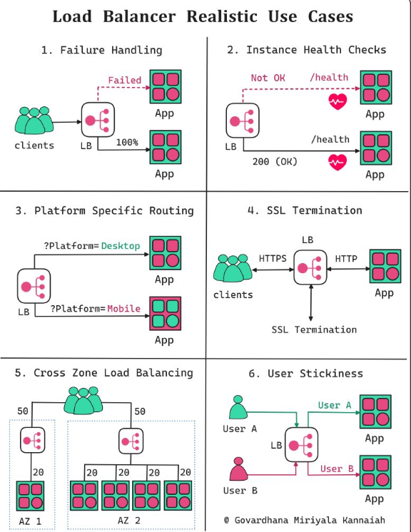

# Features

| Govardhana Miriyala Kannaiah| [Govardhana Miriyala Kannaiah](https://www.linkedin.com/in/govardhana-miriyala-kannaiah?miniProfileUrn=urn%3Ali%3Afs_miniProfile%3AACoAAAewlu4B9UDPJO4tgKaMPfpB5vXdHtKaTBE&lipi=urn%3Ali%3Apage%3Ad_flagship3_detail_base%3Bdy6%2BrQaoTSaaHQozwhrFBA%3D%3D)

𝟭. 𝗙𝗮𝗶𝗹𝘂𝗿𝗲 𝗛𝗮𝗻𝗱𝗹𝗶𝗻𝗴:
Auto-rerouting away from failed components for high availability and minimal downtime

𝟮. 𝗜𝗻𝘀𝘁𝗮𝗻𝗰𝗲 𝗛𝗲𝗮𝗹𝘁𝗵 𝗖𝗵𝗲𝗰𝗸𝘀:
Regularly monitors and verifies the instances health, ensuring incoming traffic solely to operational, healthy instances

𝟯. 𝗣𝗹𝗮𝘁𝗳𝗼𝗿𝗺 𝗦𝗽𝗲𝗰𝗶𝗳𝗶𝗰 𝗥𝗼𝘂𝘁𝗶𝗻𝗴:
Directs platform-specific (mobile, desktop etc.,) requests to separate backend servers for tailored responses

𝟰. 𝗦𝗦𝗟 𝗧𝗲𝗿𝗺𝗶𝗻𝗮𝘁𝗶𝗼𝗻:
Offloads SSL encryption/decryption, easing backend server load

𝟱. 𝗖𝗿𝗼𝘀𝘀 𝗭𝗼𝗻𝗲 𝗟𝗼𝗮𝗱 𝗕𝗮𝗹𝗮𝗻𝗰𝗶𝗻𝗴:
Evenly distribute traffic across multiple availability zones, enhancing fault tolerance and scalability

𝟲. 𝗨𝘀𝗲𝗿 𝗦𝘁𝗶𝗰𝗸𝗶𝗻𝗲𝘀𝘀:
Ensures session continuity and personalized experiences by connecting users to specific backend servers

---

 

# Strategies

| Leo Coelho | [Leo Coelho](https://www.linkedin.com/in/leo-coelho/)

The primary responsibility of a Load Balancer is to evenly distribute incoming network traffic across multiple servers or containers.

1. The Load Balancer applies its load balancing strategy to select an available container to handle the request.

2. The Load Balancer routes the request to the chosen container running the application.

3. The container processes the request, generates a response, and sends it back to the client (via the Load Balancer and API Gateway).

Here are some common load-balancing strategies.

# Round Robin

1. Round Robin: distributes sequentially across the available containers.

# Least Connection 

2. Least Connection: forwards to the container with the fewest active connections.

# IP Hash

3. IP Hash: use the client's IP address to determine the container to handle the request. It ensures that a given client always reaches the same container.

# Weighted Round Robin

4. Weighted Round Robin: Each container is assigned a weight, and requests are distributed based on the assigned weights. Containers with higher weights receive a proportionally larger share of requests.est. It ensures that a given client always reaches the same container.